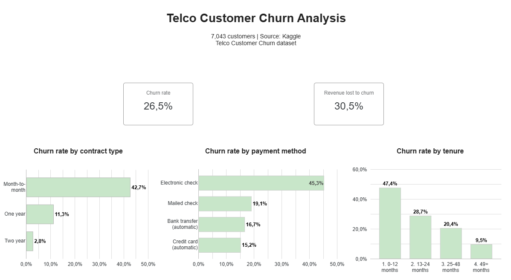

# Telco Customer Churn Analysis

An SQL and dashboard analysis of customer churn in a telecom dataset, built with BigQuery and Looker Studio.

**[Live dashboard](https://datastudio.google.com/reporting/65acb8e9-021c-4250-b843-068069c841e2)**

## Questions
1. What is the overall churn rate?
2. Which contract types and payment methods lose the most customers?
3. How does churn change with customer tenure?
4. How much monthly revenue is lost to churn?

## Key findings
- **Overall:** 26.5% of the 7,043 customers churned, and they account for 30.5% of monthly charges. The customers who leave pay more than average.
- **Contract type:** month-to-month customers churn at 42.7%, against 11.3% on one-year and 2.8% on two-year contracts.
- **Payment method:** electronic check customers churn at 45.3%, compared with 15-19% for the other methods. The gap holds within every contract type (for example 53.7% against 31.6-34.1% on month-to-month), so it is not only a contract effect.
- **Tenure:** churn is 47.4% in the first 12 months and falls to 9.5% after 49 months, so the risk is concentrated early.

## Limitations
- These are correlations, not proof of cause. Electronic check customers may differ in other ways I haven't measured.
- 11 customers have no TotalCharges value (new customers who haven't been billed yet). They were left out of any revenue calculations.
- The dataset is a public, anonymised sample, so the findings may not apply to other businesses.

## Method
1. Loaded the Kaggle "Telco Customer Churn" CSV into BigQuery.
2. Checked data quality, then wrote SQL queries in `/sql` to answer each question.
3. Built a Looker Studio dashboard from the same table, with calculated fields for churn rate, revenue lost and tenure groups.

## Tools
BigQuery (SQL), Looker Studio

## Files
- `sql/` - the queries, numbered in the order I ran them
- `screenshots/` - query results and the dashboard